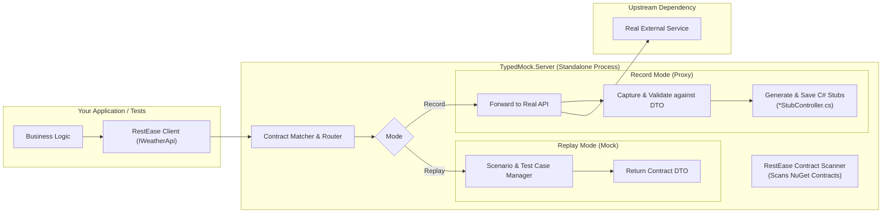

# TypedMock: Contract-Driven Mock Proxy (Proof of Concept)

> 📖 **Для обсуждения с коллегами и демо:** подготовлен русскоязычный пошаговый гид с описанием ценности, архитектуры, команд запуска и демонстрации: [**WALKTHROUGH.md**](file:///c:/Users/serge/RiderProjects/MockingProxyProofOfConcept/WALKTHROUGH.md).

A lightweight, contract-driven mocking and proxying solution for .NET microservices. It solves the maintenance nightmares of traditional record-and-replay tools (WireMock, Mountebank) by using **published NuGet integration contracts** (specifically **RestEase** interfaces and DTOs).

---

## 💡 The Core Problem & The Solution

### The Problem with Traditional Record-and-Replay
Recording raw HTTP traffic into JSON mapping files (e.g., standard WireMock/Mountebank) works well on day 1, but fails on day 30:
1. **Schema Drift**: If an external dependency modifies its API schema, raw JSON mocks continue returning old data silently, letting bugs slip into test stands and production.
2. **Maintenance Hell**: Modifying hundreds of raw JSON files with arbitrary URLs, regexes, and payload blobs is tedious and error-prone.
3. **No Compile-Time Safety**: Renaming a field in a DTO doesn't update the JSON files, leading to fragile integration tests.
4. **Flaky Sequenced Calls**: State-based call queues break when tests run in parallel or execute retries.

### The Solution: Zero-JSON Typed C# Stubs & Contract-Driven Matching
**TypedMock** turns recorded traffic directly into **strongly-typed C# ASP.NET Core controllers**:
1. **Contract-Driven**: Scans `[Get]`, `[Post]`, `[Path]`, `[Body]` attributes directly from integration contracts (RestEase / Refit or language-agnostic OpenAPI / Swagger schemas).
2. **Deterministic Request-to-Response Pattern Matching**: Incoming request DTO bodies, path variables, and query parameters are mapped directly to responses using C# pattern matching (`request switch { { City: "Berlin", TemperatureC: 23 } => ... }`).
3. **Fail-Fast at Compile Time**: If upstream removes or renames a property, your mock controllers won't compile (`CS0535` / `CS1061`). No dead JSON files in git.
4. **Stable & Idempotent**: Repeating the same request with identical parameters returns the exact same deterministic response without fragile call queues.
5. **OpenAPI / Swagger Bridge**: While .NET projects share C# contracts via NuGet, non-.NET upstream services (Go, Java, Python) can provide OpenAPI/Swagger specs to auto-generate the typed DTOs and mock controllers.

---

## 🏗️ Architecture



---

## 📂 Project Structure

- [`src/ExternalService.Contracts`](file:///c:/Users/serge/RiderProjects/MockingProxyProofOfConcept/src/ExternalService.Contracts): Simulates the published NuGet contract (`IWeatherApi`, `WeatherForecastDto`, `CreateForecastRequest`).
- [`src/ExternalService.Stubs`](file:///c:/Users/serge/RiderProjects/MockingProxyProofOfConcept/src/ExternalService.Stubs): Dedicated repository stubs project containing version-controlled C# ASP.NET Core controllers (e.g. `WeatherApiStubController.cs`). Supports in-memory test execution, standalone CLI hosting, and Docker containers.
- [`src/SampleExternalService`](file:///c:/Users/serge/RiderProjects/MockingProxyProofOfConcept/src/SampleExternalService): A sample ASP.NET Core service simulating the real external system.
- [`src/SampleClientApp`](file:///c:/Users/serge/RiderProjects/MockingProxyProofOfConcept/src/SampleClientApp): The application calling the service via RestEase `RestClient.For<IWeatherApi>()`.
- [`src/TypedMock.Core`](file:///c:/Users/serge/RiderProjects/MockingProxyProofOfConcept/src/TypedMock.Core): The core engine:
  - `RestEaseContractScanner`: Discovers endpoints, parameters, and DTO types from interfaces.
  - `RoutePatternMatcher`: Matches incoming HTTP requests to contract methods.
  - `HttpProxyForwarder`: Reverse proxies requests to real systems, validates payloads against contract DTOs, and records typed interactions.
  - `TypedMockServer`: Embedded or standalone Kestrel host supporting Record, Replay, and Hybrid modes.
  - `Generators`: Code generation engine (`CSharpStubGenerator`, `CSharpValueEmitter`, `RecordedInteraction`) transforming captured traffic into strongly-typed C# ASP.NET Core controllers.
  - `Hosting`: Embedded test server harness (`StubServerHost`, `StubExceptionMiddleware`) for running generated controllers over HTTP.
- [`src/TypedMock.Server`](file:///c:/Users/serge/RiderProjects/MockingProxyProofOfConcept/src/TypedMock.Server): Standalone console/container executable for dev and test stands.
- [`tests/TypedMock.Tests`](file:///c:/Users/serge/RiderProjects/MockingProxyProofOfConcept/tests/TypedMock.Tests): End-to-end integration tests proving the concept.

---

## 🚀 How to Run

### 1. Run All Integration Tests
```bash
dotnet test
```
The test suite validates:
- **Scenario 1:** Recording traffic through the proxy from the real service and auto-generating strongly-typed C# stubs.
- **Scenario 2:** Replaying traffic when the real external service is completely offline.
- **Scenario 3:** Creating new test cases in C# without touching raw JSON (`mockServer.For<IWeatherApi>().Setup(...)`).
- **Scenario 4:** Simulating external service errors (e.g. HTTP 500).
- **Scenario 5:** Catching contract drift (schema mismatch between upstream response and contract DTO fails validation immediately with `ContractValidationException`).
- **Scenario 6:** Recording and replaying POST requests with body payloads.
- **C# Stub Code Generation:** Recording real traffic to emit strongly-typed ASP.NET Core controllers, in-memory Roslyn compilation, remote HTTP hosting via `StubServerHost`, manual subclass scenario overriding, compile-time contract drift detection (`CS0535`), deterministic request body pattern matching, and deduplication of repeated calls.

- **Dynamic Contract Discovery & Multi-Upstream:** Loading contracts at runtime from external assembly DLLs without compile-time references (`DynamicContractLoader`), routing multiple distinct contracts to independent external services, and batch-saving separate C# controllers via `SaveAllStubsAsync`.

### 2. Run the Standalone Server on a Test Stand

#### Replay Mode:
```bash
dotnet run --project src/TypedMock.Server -- --mode=Replay --port=5050
```

#### Record Mode (Single Upstream with Contract Assembly):
```bash
dotnet run --project src/TypedMock.Server -- --mode=Record --port=5050 --target=http://real-service:5001 --contracts=src/ExternalService.Contracts/bin/Debug/net10.0/ExternalService.Contracts.dll --out-dir=./GeneratedStubs
```

#### Record Mode (Multi-Upstream + Dynamic Contract Discovery):
```bash
dotnet run --project src/TypedMock.Server -- \
  --mode=Record \
  --port=5050 \
  --contracts-dir=./contracts \
  --upstreams="IWeatherApi=http://weather-service:5001,IPaymentApi=http://payment-service:5002" \
  --out-dir=./GeneratedStubs
```

#### Diagnostic Endpoint:
Open `http://localhost:5050/__typedmock/status` to view registered contracts, endpoints, active mode, and multi-upstream routing table.

---

## 🎯 Creating & Managing Test Scenarios

### In C# Autotests (Fluent & Compile-Time Safe):
```csharp
await using var mockServer = new TypedMockServer(new TypedMockOptions { Mode = MockMode.Replay });

// Strongly typed mock setup:
mockServer.For<IWeatherApi>()
    .Setup(x => x.GetForecastByCityAsync("London"))
    .Returns(new WeatherForecastDto
    {
        City = "London",
        Date = DateOnly.FromDateTime(DateTime.Today),
        TemperatureC = 20,
        Summary = "Sunny"
    });

await mockServer.StartAsync();

// RestEase client connects to mockServer.BaseUrl
var client = RestClient.For<IWeatherApi>(mockServer.BaseUrl);
var forecast = await client.GetForecastByCityAsync("London");
```

### On Test Stands (via Header or Query Parameter):
Clients or QA test runners can select specific scenarios by providing the `X-Mock-Scenario` header:
```http
GET /weatherforecast/London HTTP/1.1
Host: mock-server:5050
X-Mock-Scenario: StormWarning
```
TypedMock will resolve the mock scenario rule registered in code or invoke the overridden scenario hook in the generated C# stub controller.

---

## 🔄 Repository-First Stub Distribution & Replay Modes

TypedMock adopts a repository-first distribution workflow that bridges recorded traffic with version-controlled C# source code:

```
[Record Traffic from Real Upstream]
              │
              ▼
[Save C# Controllers to src/ExternalService.Stubs/Controllers/]
              │
              ▼
[Git Commit: Compile Safety, Drift Detection, Pull Request Diff]
              │
  ┌───────────┼───────────────────────────┐
  ▼           ▼                           ▼
[In-Memory] [Standalone CLI Host]   [Docker Container]
TypedMockServer   dotnet run --project       docker run -p 5050:5050
.RegisterStubController<T>()  src/ExternalService.Stubs -- 5050   external-stubs
```

### 1. Unified Request Pipeline Dispatch Precedence
`TypedMockServer` executes a unified Kestrel pipeline in Replay mode:
1. **Admin Diagnostic Endpoints**: `/__typedmock/status` handles management and health queries.
2. **Scenario Context Middleware**: Extracts scenario from `X-Mock-Scenario` header or `?__scenario=` query parameter and populates `HttpContext.Items["TypedMock.Scenario"]`.
3. **MVC Stub Controllers**: Endpoints registered via `mockServer.RegisterStubController<TController>()` execute baseline switch pattern matching and scenario hooks.
4. **Programmatic Rules**: Unmatched endpoints fall through to `.For<TContract>().Setup(...)` mock rules.
5. **Hybrid Forwarding**: In Hybrid mode, unmatched calls forward to real upstream; otherwise returns HTTP 404.

### 2. Hosting Pre-compiled Stubs in Integration Tests
```csharp
await using var mockServer = new TypedMockServer(new TypedMockOptions { Mode = MockMode.Replay });
mockServer.RegisterStubController<WeatherApiStubController>();
await mockServer.StartAsync();

var client = RestClient.For<IWeatherApi>(mockServer.BaseUrl);
var forecast = await client.GetForecastByCityAsync("London");
```

### 3. Running Stubs as a Standalone CLI Host
```bash
dotnet run --project src/ExternalService.Stubs -- 5050
```

### 4. Running Stubs in Docker
```bash
# Build stubs image
docker build -t external-stubs -f src/ExternalService.Stubs/Dockerfile .

# Run container
docker run -d -p 5050:5050 external-stubs
```

---

## 📦 Packaging & Docker

### 1. NuGet Packages

The solution produces two packages:
- **`TypedMock.Core`**: Class library for embedding inside integration tests, xUnit/NUnit suites, and WebApplicationFactory harnesses.
- **`TypedMock.Server`**: Standalone proxy CLI and .NET Global Tool (`typedmock`).

```bash
# Pack NuGet packages
dotnet pack src/TypedMock.Core/TypedMock.Core.csproj -c Release
dotnet pack src/TypedMock.Server/TypedMock.Server.csproj -c Release

# Install standalone CLI locally as a global tool
dotnet tool install -g --add-source ./src/TypedMock.Server/bin/Release TypedMock.Server
```

### 2. Docker & Docker Compose

A multi-stage `Dockerfile` and `docker-compose.yml` are provided for containerized test stands:

```bash
# Build Docker image
docker build -t typedmock:latest .

# Run with docker compose (mounts ./contracts and ./GeneratedStubs)
docker compose up -d

# Check diagnostic endpoint
curl http://localhost:5050/__typedmock/status
```

---

## 📚 In-Depth Guides

- [**WALKTHROUGH.md**](file:///c:/Users/serge/RiderProjects/MockingProxyProofOfConcept/WALKTHROUGH.md): Пошаговое руководство на русском языке для обсуждения с командой, аргументы за внедрение, живое демо и часто задаваемые вопросы.
- [**Contract-Driven C# Code-Generated Stub Controllers**](file:///c:/Users/serge/RiderProjects/MockingProxyProofOfConcept/docs/CSHARP_CODEGEN_STUB_CONTROLLERS.md): Complete guide to recording traffic and emitting version-controlled C# ASP.NET Core controllers with baseline switch dispatches, manual subclass scenario hooks, in-memory unit testing, and compile-time drift detection.

