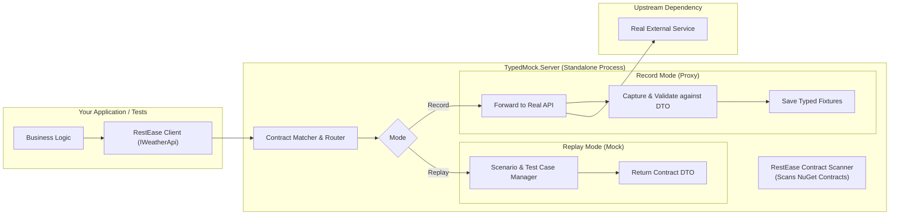

# TypedMock: Contract-Driven Mock Proxy (Proof of Concept)

A lightweight, contract-driven mocking and proxying solution for .NET microservices. It solves the maintenance nightmares of traditional record-and-replay tools (WireMock, Mountebank) by using **published NuGet integration contracts** (specifically **RestEase** interfaces and DTOs).

---

## 💡 The Core Problem & The Solution

### The Problem with Traditional Record-and-Replay
Recording raw HTTP traffic into JSON mapping files (e.g., standard WireMock/Mountebank) works well on day 1, but fails on day 30:
1. **Schema Drift**: If an external dependency modifies its API schema, raw JSON mocks continue returning old data silently, letting bugs slip into test stands and production.
2. **Maintenance Hell**: Modifying hundreds of raw JSON files with arbitrary URLs, regexes, and payload blobs is tedious and error-prone.
3. **No Compile-Time Safety**: Renaming a field in a DTO doesn't update the JSON files, leading to fragile integration tests.

### The Solution: RestEase Contract-Driven Mocking
Most .NET enterprise services publish integration contracts as NuGet packages (RestEase interfaces + DTO models).
**TypedMock** uses these contracts to:
1. **Automatically Discover Routes & Types**: Scans `[Get]`, `[Post]`, `[Path]`, `[Body]` attributes directly from your NuGet interfaces (`IWeatherApi`).
2. **Enforce Type Safety on Recorded Traffic**: When proxying to the real service, responses are validated and deserialized against the C# DTO types before saving.
3. **Catch Schema Drift Immediately**: If a fixture's data cannot be deserialized into the contract DTO, `ContractValidationException` is thrown at test/startup time.
4. **Compile-Time Test Case Creation**: Allows defining new mock scenarios directly in C# using fluent lambda expressions or scenario headers (`X-Mock-Scenario`).

---

## 🏗️ Architecture



---

## 📂 Project Structure

- [`src/ExternalService.Contracts`](file:///c:/Users/serge/RiderProjects/MockingProxyProofOfConcept/src/ExternalService.Contracts): Simulates the published NuGet contract (`IWeatherApi`, `WeatherForecastDto`, `CreateForecastRequest`).
- [`src/SampleExternalService`](file:///c:/Users/serge/RiderProjects/MockingProxyProofOfConcept/src/SampleExternalService): A sample ASP.NET Core service simulating the real external system.
- [`src/SampleClientApp`](file:///c:/Users/serge/RiderProjects/MockingProxyProofOfConcept/src/SampleClientApp): The application calling the service via RestEase `RestClient.For<IWeatherApi>()`.
- [`src/TypedMock.Core`](file:///c:/Users/serge/RiderProjects/MockingProxyProofOfConcept/src/TypedMock.Core): The core engine:
  - `RestEaseContractScanner`: Discovers endpoints, parameters, and DTO types from interfaces.
  - `RoutePatternMatcher`: Matches incoming HTTP requests to contract methods.
  - `TypedFixtureStore`: Manages typed JSON fixtures and validates them against DTOs.
  - `HttpProxyForwarder`: Reverse proxies requests to real systems and records typed interactions.
  - `TypedMockServer`: Embedded or standalone Kestrel host supporting Record, Replay, and Hybrid modes.
- [`src/TypedMock.Server`](file:///c:/Users/serge/RiderProjects/MockingProxyProofOfConcept/src/TypedMock.Server): Standalone console/container executable for dev and test stands.
- [`tests/TypedMock.Tests`](file:///c:/Users/serge/RiderProjects/MockingProxyProofOfConcept/tests/TypedMock.Tests): End-to-end integration tests proving the concept.

---

## 🚀 How to Run

### 1. Run All Integration Tests
```bash
dotnet test
```
The test suite validates:
- **Scenario 1:** Recording traffic through the proxy from the real service and auto-generating validated fixtures.
- **Scenario 2:** Replaying traffic when the real external service is completely offline.
- **Scenario 3:** Creating new test cases in C# without touch raw JSON (`mockServer.For<IWeatherApi>().Setup(...)`).
- **Scenario 4:** Simulating external service errors (e.g. HTTP 500).
- **Scenario 5:** Catching contract drift (broken/corrupted fixtures fail validation immediately).
- **Scenario 6:** Recording and replaying POST requests with body payloads.

### 2. Run the Standalone Server on a Test Stand

#### Replay Mode (Default Mocking Stand):
```bash
dotnet run --project src/TypedMock.Server -- --mode=Replay --port=5050 --fixtures=./fixtures
```

#### Record Mode (Interception Proxy):
```bash
dotnet run --project src/TypedMock.Server -- --mode=Record --port=5050 --target=http://real-service:5001 --fixtures=./fixtures
```

#### Diagnostic Endpoint:
Open `http://localhost:5050/__typedmock/status` to view registered contracts, endpoints, active mode, and loaded fixtures.

---

## 🎯 Creating & Managing Test Scenarios

### In C# Autotests (Fluent & Compile-Time Safe):
```csharp
await using var mockServer = new TypedMockServer(new TypedMockOptions { Mode = MockMode.Replay });

// Strongly typed mock setup:
mockServer.For<IWeatherApi>()
    .Setup(x => x.GetForecastByCityAsync("London"))
    .Returns(new WeatherForecastDto
    {
        City = "London",
        Date = DateOnly.FromDateTime(DateTime.Today),
        TemperatureC = 20,
        Summary = "Sunny"
    });

await mockServer.StartAsync();

// RestEase client connects to mockServer.BaseUrl
var client = RestClient.For<IWeatherApi>(mockServer.BaseUrl);
var forecast = await client.GetForecastByCityAsync("London");
```

### On Test Stands (via Header or Query Parameter):
Clients or QA test runners can select specific scenarios by providing the `X-Mock-Scenario` header:
```http
GET /weatherforecast/London HTTP/1.1
Host: mock-server:5050
X-Mock-Scenario: StormWarning
```
TypedMock will automatically resolve the fixture matching `IWeatherApi/GetForecastByCityAsync/StormWarning.json`.
