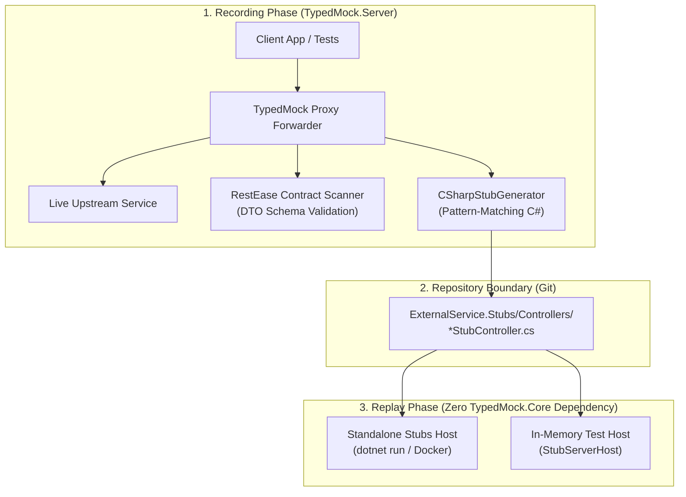

# TypedMock: Contract-Driven Mock Proxy (Proof of Concept)

> 📖 **Для обсуждения с коллегами и демо:** подготовлен русскоязычный пошаговый гид с описанием ценности, архитектуры, команд запуска и демонстрации: [**WALKTHROUGH.md**](file:///c:/Users/serge/RiderProjects/MockingProxyProofOfConcept/WALKTHROUGH.md).

A lightweight, contract-driven mocking and proxying solution for .NET microservices. It solves the maintenance nightmares of traditional record-and-replay tools (WireMock, Mountebank) by using **published NuGet integration contracts** (specifically **RestEase** interfaces and DTOs) to generate **zero-dependency, strongly-typed C# ASP.NET Core controllers**.

---

## 💡 The Core Problem & The Solution

### The Problem with Traditional Record-and-Replay
Recording raw HTTP traffic into JSON mapping files (e.g., standard WireMock/Mountebank) works well on day 1, but fails on day 30:
1. **Schema Drift**: If an external dependency modifies its API schema, raw JSON mocks continue returning old data silently, letting bugs slip into test stands and production.
2. **Maintenance Hell**: Modifying hundreds of raw JSON files with arbitrary URLs, regexes, and payload blobs is tedious and error-prone.
3. **No Compile-Time Safety**: Renaming a field in a DTO doesn't update the JSON files, leading to fragile integration tests.
4. **Flaky Sequenced Calls**: State-based call queues break when tests run in parallel or execute retries.

### The Solution: Zero-JSON Typed C# Stubs & Standalone Hosts
**TypedMock** turns recorded traffic directly into **strongly-typed, version-controlled C# ASP.NET Core controllers**:
1. **Contract-Driven**: Scans `[Get]`, `[Post]`, `[Path]`, `[Body]` attributes directly from integration contracts (RestEase / Refit or language-agnostic OpenAPI / Swagger schemas).
2. **Deterministic Request-to-Response Pattern Matching**: Incoming request DTO bodies, path variables, and query parameters are mapped directly to responses using C# pattern matching (`request switch { { City: "Berlin", TemperatureC: 23 } => ... }`).
3. **Fail-Fast at Compile Time**: If upstream removes or renames a property, your mock controllers won't compile (`CS0535` / `CS1061`). No dead JSON files in git.
4. **Zero-Dependency Stubs Project**: Generated controllers and stubs projects are plain ASP.NET Core apps referencing only your contracts—they have **zero runtime dependency** on `TypedMock.Core`.
5. **Stable & Idempotent**: Repeating the same request with identical parameters returns the exact same deterministic response without fragile call queues.
6. **OpenAPI / Swagger Bridge**: While .NET projects share C# contracts via NuGet, non-.NET upstream services (Go, Java, Python) can provide OpenAPI/Swagger specs to auto-generate typed DTOs and mock controllers.

---

## 🏗️ Architecture

The architecture enforces a clean separation of concerns: **the recorder is a dev-time tool**, and **the stubs host is a lightweight, zero-dependency replay server**.



---

## 📂 Project Structure

- [`src/ExternalService.Contracts`](file:///c:/Users/serge/RiderProjects/MockingProxyProofOfConcept/src/ExternalService.Contracts): Simulates the published NuGet contract (`IWeatherApi`, `WeatherForecastDto`, `CreateForecastRequest`).
- [`src/ExternalService.Stubs`](file:///c:/Users/serge/RiderProjects/MockingProxyProofOfConcept/src/ExternalService.Stubs): Dedicated repository stubs project containing version-controlled C# ASP.NET Core controllers (e.g. `WeatherApiStubController.cs`). Zero runtime dependency on `TypedMock.Core` — references only `ExternalService.Contracts`. Supports standalone CLI hosting (`Program.cs`), Docker containers (`Dockerfile`), and in-memory test hosting.
- [`src/TypedMock.Core`](file:///c:/Users/serge/RiderProjects/MockingProxyProofOfConcept/src/TypedMock.Core): The core recording and code-generation engine:
  - `RestEaseContractScanner`: Discovers endpoints, parameters, and DTO types from interfaces.
  - `DynamicContractLoader`: Dynamically loads contracts from external assemblies or directories at runtime.
  - `HttpProxyForwarder`: Reverse proxies requests to real systems, validates payloads against contract DTOs in real-time, and records typed interactions.
  - `TypedMockServer`: Embedded reverse proxy server that records interactions and batch-saves C# stub controllers.
  - `Generators`: Code generation engine (`CSharpStubGenerator`, `CSharpValueEmitter`, `RecordedInteraction`) transforming captured traffic into strongly-typed C# ASP.NET Core controllers.
  - `Hosting`: Embedded test server harness (`StubServerHost`, `StubExceptionMiddleware`) for running compiled controllers over HTTP in integration tests.
- [`src/TypedMock.Server`](file:///c:/Users/serge/RiderProjects/MockingProxyProofOfConcept/src/TypedMock.Server): Standalone CLI tool (`typedmock`) for running the recording proxy and scaffolding new stubs projects (`init`).
- [`src/SampleExternalService`](file:///c:/Users/serge/RiderProjects/MockingProxyProofOfConcept/src/SampleExternalService): A sample ASP.NET Core service simulating the real external system.
- [`src/SampleClientApp`](file:///c:/Users/serge/RiderProjects/MockingProxyProofOfConcept/src/SampleClientApp): The application calling the service via RestEase `RestClient.For<IWeatherApi>()`.
- [`tests/TypedMock.Tests`](file:///c:/Users/serge/RiderProjects/MockingProxyProofOfConcept/tests/TypedMock.Tests): End-to-end integration tests proving recording, stub generation, schema validation, multi-upstream routing, and stub hosting.

---

## 🚀 How to Run

### 1. Run All Integration Tests
```bash
dotnet test
```
The test suite validates:
- **Contract-Driven Recording & Code Generation:** Recording real traffic through the proxy and emitting strongly-typed ASP.NET Core controllers with deterministic switch pattern-matching.
- **Fail-Fast Compile-Time Drift Detection:** Modifying contract interfaces causes immediate compile-time errors (`CS0535`) in generated stub controllers.
- **Runtime Schema Drift Validation:** Upstream responses violating contract DTO schemas throw `ContractValidationException` immediately.
- **Multi-Upstream Routing & Dynamic Discovery:** Scanning contracts dynamically from external assemblies or directories without compile-time references, routing distinct contracts to separate backends, and batch-saving stubs via `SaveAllStubsAsync`.
- **Zero-Dependency Stub Hosting:** Serving traffic from compiled stub controllers via `StubServerHost` in tests or standalone host with scenario resolution (`X-Mock-Scenario` / `__scenario`).

### 2. Scaffold a New Stubs Project (`typedmock init`)
```bash
dotnet run --project src/TypedMock.Server -- init \
  --name=MyService.Stubs \
  --contracts=src/ExternalService.Contracts/ExternalService.Contracts.csproj \
  --out-dir=./src
```
This generates a self-contained ASP.NET Core project with `.csproj` (referencing only the contracts), `Program.cs` (with built-in scenario resolution middleware), `Dockerfile`, and `Controllers/` directory.

### 3. Record Traffic from Upstream Service
```bash
# Single upstream target:
dotnet run --project src/TypedMock.Server -- \
  --port=5050 \
  --target=http://localhost:5001 \
  --contracts=src/ExternalService.Contracts/bin/Debug/net10.0/ExternalService.Contracts.dll \
  --out-dir=./src/ExternalService.Stubs/Controllers

# Multi-upstream routing:
dotnet run --project src/TypedMock.Server -- \
  --port=5050 \
  --contracts-dir=./contracts \
  --upstreams="IWeatherApi=http://localhost:5001,IPaymentApi=http://localhost:5002" \
  --out-dir=./src/ExternalService.Stubs/Controllers
```
Make requests through `http://localhost:5050`. When you stop the proxy (`Ctrl+C`), strongly-typed C# stub controllers are automatically generated and saved!

### 4. Run the Stubs Host Standalone
Once recorded, the stubs project runs completely independently without any dependency on `TypedMock.Core`:
```bash
dotnet run --project src/ExternalService.Stubs -- 5050
```

---

## 🎯 Controlling Scenarios & Edge Cases

### 1. In C# Controllers (Extensibility Hooks)
Generated controllers contain virtual hook methods (`On<Method>Async`) that can be overridden in partial classes or subclasses to simulate errors or custom return data:

```csharp
[ApiController]
public class CustomWeatherStubController : WeatherApiStubController
{
    protected override Task<WeatherForecastDto?> OnGetForecastByCityAsync(string city)
    {
        if (string.Equals(city, "StormCity", StringComparison.OrdinalIgnoreCase))
        {
            return Task.FromResult<WeatherForecastDto?>(new WeatherForecastDto
            {
                City = "StormCity",
                TemperatureC = -15,
                Summary = "Blizzard"
            });
        }

        return base.OnGetForecastByCityAsync(city);
    }
}
```

### 2. Via Scenario Headers / Query Parameters
Clients and test runners can request specific scenarios using the `X-Mock-Scenario` header or query string:
```http
GET /weatherforecast/London HTTP/1.1
Host: mock-server:5050
X-Mock-Scenario: StormWarning
```
The stubs host automatically propagates the active scenario into `HttpContext.Items["TypedMock.Scenario"]` for controller actions to inspect.

### 3. In Integration Tests (In-Memory Hosting)
```csharp
// Host the compiled stub controller in-memory during tests
await using var stubHost = await StubServerHost.StartAsync<WeatherApiStubController>(port: 0);
var url = StubServerHost.GetServerUrl(stubHost);

var client = RestClient.For<IWeatherApi>(url);
var forecast = await client.GetForecastByCityAsync("London");
```

---

## 📦 Packaging & Docker

### 1. NuGet Packages
- **`TypedMock.Core`**: Recording proxy engine, RestEase contract scanner, and C# code generator.
- **`TypedMock.Server`**: Standalone recording proxy CLI and stubs scaffolder (`typedmock`).

```bash
dotnet pack src/TypedMock.Core/TypedMock.Core.csproj -c Release
dotnet pack src/TypedMock.Server/TypedMock.Server.csproj -c Release
```

### 2. Docker
Both the recording proxy and the standalone stubs projects include Dockerfiles for containerized environments:

```bash
# Build and run the standalone stubs host
docker build -t external-stubs -f src/ExternalService.Stubs/Dockerfile .
docker run -d -p 5050:5050 external-stubs
```

---

## 📚 In-Depth Guides

- [**WALKTHROUGH.md**](file:///c:/Users/serge/RiderProjects/MockingProxyProofOfConcept/WALKTHROUGH.md): Пошаговое руководство на русском языке для обсуждения с командой, аргументы за внедрение, живое демо и часто задаваемые вопросы.
- [**Contract-Driven C# Code-Generated Stub Controllers**](file:///c:/Users/serge/RiderProjects/MockingProxyProofOfConcept/docs/CSHARP_CODEGEN_STUB_CONTROLLERS.md): Complete guide to recording traffic and emitting version-controlled C# ASP.NET Core controllers with baseline switch pattern-matching, subclass scenario hooks, in-memory unit testing, and compile-time drift detection.
