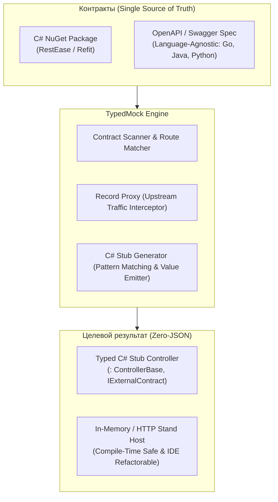

# TypedMock: Пошаговый гид, примеры работы и профит для обсуждения с командой

Этот документ подготовлен для демонстрации концепта **TypedMock** коллегам (архитекторам, разработчикам, SDET/QA). В нем собрана суть проблемы, архитектура решения, примеры артефактов на выходе, пошаговые команды для живого демо и аргументы «зачем это нужно проекту».

---

## 1. В чем задача и исходная боль (Why?)

### Как сегодня тестируются микросервисы, зависящие от внешних API:
1. **Прямые вызовы реальных сервисов на тестовых стендах (Integration Env):**
   - **Нестабильность (Flaky):** Внешний стенд упал, перезагружается или сеть моргнула — тесты красные, пайплайн заблокирован.
   - **Невозможность воспроизвести краевые случаи:** Как проверить 500 Internal Error от платежного шлюза, таймаут или редкий статус заказа, если боевой/тестовый API их не отдает по запросу?
   - **Конфликты данных:** Несколько команд или параллельных тестов одновременно меняют одни и те же сущности.

2. **Классический Record-and-Replay (WireMock, Mountebank и сырые JSON-маппинги):**
   - **Проблема Schema Drift (тихое устаревание):** Сторонняя команда обновила API (переименовала поле `userId` -> `accountId`, изменила тип поля). Ваш WireMock продолжает радостно отдавать старый сохраненный JSON. Все тесты **зеленые**, а при выкатке на прод сервис **падает с рантайм-ошибкой**.
   - **Ад поддержки:** Сотни разрозненных JSON-файлов с регулярными выражениями и дублирующимися URL-паттернами. При любом изменении DTO разработчики боятся трогать моки.

3. **In-Memory моки (`Mock<T>`, Fake HttpClient):**
   - Оторваны от реальности: не проверяют реальный HTTP-пайплайн, сериализацию System.Text.Json/Newtonsoft, заголовки, кодировки и роутинг.

---

## 2. Что получилось: Ключевая идея TypedMock

### 💡 Концептуальный сдвиг: «JSON не нужен — сразу C# код»
Традиционные инструменты (WireMock, Mountebank) сохраняют трафик в сотни мёртвых JSON-файлов:
- JSON не проверяется компилятором `dotnet build`.
- При переименовании полей DTO JSON тихо устаревает (Schema Drift).
- JSON невозможно автоматически отрефакторить средствами IDE (`F2 / Rename`).

В **TypedMock** мы отказываемся от промежуточного JSON в пользу **прямой генерации компилируемых C# контроллеров**:
1. **Compile-Time безопасность:** При обновлении контрактов стабы либо компилируются, либо компилятор сразу показывает ошибку (`CS0535` / `CS1061`).
2. **Детерминированный Pattern-Matching:** Входной запрос (Route, Query, Request Body DTO) строго связывается с конкретным ответом прямо в C#-коде (`request switch { { City: "Berlin", TemperatureC: 23 } => ... }`).
3. **Повторные вызовы (Idempotency):** Никаких нестабильных очередей (queues/sequences) — один и тот же запрос всегда детерминированно возвращает один и тот же записанный ответ, выдерживая ретраи (Polly) и параллельные вызовы.
4. **Языковая независимость через OpenAPI / Swagger:** Контракт может поступать не только как C# NuGet, но и как Swagger/OpenAPI спецификация (от сервисов на Go, Java, Python), из которой генерируются типизированные C# DTO и стабы.



### Защита от дрифта и повторяющихся вызовов:
1. **Детерминированное связывание «Вход -> Ответ»:** Входные DTO и параметры запроса превращаются в C# Pattern Matching. Если для данного запроса нет записанного ответа, возвращается `404 Not Found` (`StubNotFoundException`), а не случайные данные.
2. **Дедупликация:** Повторные запросы с идентичным телом или параметрами не дублируют код, а сливаются в один стабильный case в `switch`.
3. **Compile-Time защита (C# Stubs):** При удалении или переименовании поля в DTO сгенерированные моки немедленно выдают ошибку компиляции.

---

## 3. Что есть в решении (Компоненты)

Решение собрано на **.NET 10** (`net10.0`), полностью отформатировано и покрыто тестами:

| Проект | Назначение |
|---|---|
| [`src/ExternalService.Contracts`](file:///c:/Users/serge/RiderProjects/MockingProxyProofOfConcept/src/ExternalService.Contracts) | Имитация NuGet-пакета внешней команды: интерфейс `IWeatherApi` с аннотациями RestEase (`[Get]`, `[Post]`, `[Path]`, `[Body]`) и DTO-модели. |
| [`src/TypedMock.Core`](file:///c:/Users/serge/RiderProjects/MockingProxyProofOfConcept/src/TypedMock.Core) | Ядро движка: встроенный Kestrel, сканер контрактов, матчер роутов, валидатор схем, обратный прокси, генератор C# стабов и in-memory тестовый хост. |
| [`src/TypedMock.Server`](file:///c:/Users/serge/RiderProjects/MockingProxyProofOfConcept/src/TypedMock.Server) | Standalone CLI-приложение для запуска на тестовых стендах / в Docker-контейнерах. Поддерживает режимы `--mode=Record` / `--mode=Replay` и endpoint диагностики `/__typedmock/status`. |
| [`src/SampleExternalService`](file:///c:/Users/serge/RiderProjects/MockingProxyProofOfConcept/src/SampleExternalService) | Реальный внешний веб-сервис для записи трафика. |
| [`src/SampleClientApp`](file:///c:/Users/serge/RiderProjects/MockingProxyProofOfConcept/src/SampleClientApp) | Потребительский микросервис, вызывающий внешнее API через `RestClient.For<IWeatherApi>()`. |
| [`tests/TypedMock.Tests`](file:///c:/Users/serge/RiderProjects/MockingProxyProofOfConcept/tests/TypedMock.Tests) | 19 интеграционных тестов, подтверждающих все сценарии (запись, воспроизведение, C# Setup, симуляция 500-х ошибок, обнаружение дрифта, C# генерация с pattern-matching, дедупликация и повторные вызовы). |

---

## 4. Что мы получаем на выходе (Артефакты)

### Главный артефакт: Сгенерированный C# контроллер-стаб (Zero-JSON подход)
TypedMock переводит записанные HTTP-сессии напрямую в чистый, типизированный C# код с детерминированным pattern-matching:

```csharp
namespace Generated.Stubs;

[ApiController]
public partial class WeatherApiStubController : ControllerBase, IWeatherApi
{
    // 1. GET без параметров: возвращает зафиксированный типизированный список
    [HttpGet("weatherforecast")]
    public virtual async Task<List<WeatherForecastDto>> GetForecastsAsync()
    {
        var custom = await OnGetForecastsAsync();
        if (custom != null) return custom;

        return new List<WeatherForecastDto>
        {
            new WeatherForecastDto { City = "London", TemperatureC = 12, Summary = "Chilly" },
            new WeatherForecastDto { City = "Paris", TemperatureC = 18, Summary = "Mild" }
        };
    }

    // 2. GET с Path-параметром: сопоставление по параметрам маршрута
    [HttpGet("weatherforecast/{city}")]
    public virtual async Task<WeatherForecastDto> GetForecastByCityAsync([FromRoute(Name = "city")] string city)
    {
        var custom = await OnGetForecastByCityAsync(city);
        if (custom != null) return custom;

        return (city?.ToLowerInvariant()) switch
        {
            "london" => new WeatherForecastDto { City = "London", TemperatureC = 12, Summary = "Chilly" },
            "paris" => new WeatherForecastDto { City = "Paris", TemperatureC = 18, Summary = "Mild" },
            _ => throw new StubNotFoundException($"No recorded stub for city '{city}'.")
        };
    }

    // 3. POST с телом запроса: Property Pattern Matching по входящему DTO
    [HttpPost("weatherforecast")]
    public virtual async Task<WeatherForecastDto> CreateForecastAsync([FromBody] CreateForecastRequest request)
    {
        var custom = await OnCreateForecastAsync(request);
        if (custom != null) return custom;

        return request switch
        {
            { City: "Berlin", TemperatureC: 23, Summary: "Sunny and clear" } =>
                new WeatherForecastDto
                {
                    City = "Berlin",
                    TemperatureC = 23,
                    Summary = "Sunny and clear",
                    Date = DateOnly.Parse("2026-11-11", CultureInfo.InvariantCulture)
                },
            { City: "Rome", TemperatureC: 28, Summary: "Hot" } =>
                new WeatherForecastDto
                {
                    City = "Rome",
                    TemperatureC = 28,
                    Summary = "Hot",
                    Date = DateOnly.Parse("2026-11-11", CultureInfo.InvariantCulture)
                },
            _ => throw new StubNotFoundException($"No recorded stub for request '{request}'.")
        };
    }

    // Точки расширения для кастомных сценариев и fault injection в автотестах:
    protected virtual Task<WeatherForecastDto?> OnGetForecastByCityAsync(string city) => Task.FromResult<WeatherForecastDto?>(null);
    protected virtual Task<WeatherForecastDto?> OnCreateForecastAsync(CreateForecastRequest request) => Task.FromResult<WeatherForecastDto?>(null);
}
```

### Диагностика стенда в реальном времени
Эндпоинт `GET /__typedmock/status` возвращает текущее состояние:
- Текущий режим работы (`Record`, `Replay`, `Hybrid`).
- Целевой адрес реального сервиса (`targetUrl`).
- Зарегистрированные интерфейсы и их методы.
- Список загруженных сценариев.

---

## 5. Пошаговое руководство: Что запустить и как проверить (Live Demo)

Для демонстрации коллегам достаточно пройти следующие шаги в терминале.

### Шаг 0: Запуск всех интеграционных тестов
Убеждаемся, что все 20 тестов проходят:
```bash
dotnet test
```
*Результат: 20 passed.* Тесты демонстрируют программный C# API, сетевое проксирование, динамическую загрузку сборок в рантайме (`DynamicContractLoader`), Multi-Upstream маршрутизацию и пакетную генерацию контроллеров.

---

### Шаг 1: Запуск живого внешнего сервиса (Upstream)
В первом окне терминала поднимаем образцовый сервис погоды:
```bash
dotnet run --project src/SampleExternalService -- 5001
```
Сервис слушает на `http://localhost:5001`.

---

### Шаг 2: Запуск TypedMock в режиме Record (Запись трафика)
Во втором окне терминала запускаем TypedMock-прокси:
```bash
dotnet run --project src/TypedMock.Server -- --mode=Record --port=5050 --target=http://localhost:5001 --fixtures=./demo-fixtures
```
TypedMock слушает на `http://localhost:5050`, регистрирует контракт `IWeatherApi` и готов прозрачно проксировать запросы на порт `5001`.

Проверяем диагностику в браузере или через curl:
```bash
curl http://localhost:5050/__typedmock/status
```

---

### Шаг 3: Клиент делает запросы через TypedMock
В третьем окне терминала запускаем клиентское приложение, указав адрес прокси `http://localhost:5050`:
```bash
dotnet run --project src/SampleClientApp -- http://localhost:5050
```
**Что происходит:**
1. Клиент запрашивает данные о погоде (`London`, `Paris` и т.д.).
2. TypedMock перехватывает запрос, сопоставляет его с `IWeatherApi.GetForecastByCityAsync`.
3. Пересылает запрос в настоящий сервис на порту 5001.
4. Получает ответ, **валидирует его через DTO**, отдает клиенту и сохраняет в каталог `./demo-fixtures`.

Загляните в папку `./demo-fixtures/IWeatherApi/GetForecastByCityAsync/` — там появились типизированные JSON-файлы с реальными ответами!

---

### Шаг 4: Режим Replay (Внешний сервис отключен!)
1. Остановите реальный сервис в первом терминале (`Ctrl+C`). Теперь внешнего API нет!
2. Перезапустите TypedMock в режиме **Replay**:
```bash
dotnet run --project src/TypedMock.Server -- --mode=Replay --port=5050 --fixtures=./demo-fixtures
```
3. Снова запустите клиент:
```bash
dotnet run --project src/SampleClientApp -- http://localhost:5050
```
**Результат:** Клиент отработал штатно и получил все данные, хотя реальный бэкенд выключен.

---

### Шаг 5: Переключение сценариев «на лету» (для QA и тестовых стендов)
Клиент может запросить специфический сценарий с помощью HTTP-заголовка:
```bash
curl -H "X-Mock-Scenario: StormWarning" http://localhost:5050/weatherforecast/London
```
Или через query-параметр:
```bash
curl "http://localhost:5050/weatherforecast/London?__scenario=StormWarning"
```
Сервер автоматически вернет фикстуру из файла `StormWarning.json`. Если сценарий не найден, он вернет дефолтный ответ или 404 с понятным описанием доступных сценариев.

---

### Шаг 6: Демонстрация защиты от Schema Drift (Ломаем контракт)
Откройте файл `./demo-fixtures/IWeatherApi/GetForecastByCityAsync/city_London.json` и испортите тип данных (например, сделайте `"temperatureC": "NotANumber"` или передайте невалидный формат даты).

Попробуйте запустить клиент или тест:
- TypedMock **откажется отдавать невалидный ответ** и вернет понятную ошибку `ContractValidationException`:
  > *"Schema drift detected! Fixture payload does not match contract DTO WeatherForecastDto."*

Это гарантирует, что устаревшие моки никогда не просочатся незамеченными.

---

### Шаг 7: Использование в C# автотестах (Fluent Setup)
Разработчикам не обязательно работать с файлами на диске. В коде тестов всё настраивается привычным строго типизированным стилем:

```csharp
[Fact]
public async Task MyIntegrationTest()
{
    await using var mockServer = new TypedMockServer(new TypedMockOptions { Mode = MockMode.Replay });

    // Строго типизированный сетап с автодополнением полей IDE:
    mockServer.For<IWeatherApi>()
        .Setup(x => x.GetForecastByCityAsync("London"))
        .Returns(new WeatherForecastDto
        {
            City = "London",
            TemperatureC = 30,
            Summary = "Heatwave"
        });

    await mockServer.StartAsync();

    // Тестируемый сервис указывает на mockServer.BaseUrl
    var client = RestClient.For<IWeatherApi>(mockServer.BaseUrl);
    var result = await client.GetForecastByCityAsync("London");

    result.Summary.Should().Be("Heatwave");
}
```

---

## 6. В чем профит для команды (Аргументы для обсуждения)

### Сравнительный анализ подходов

| Критерий | Тестирование на живых стендах | WireMock / Mountebank | TypedMock (Наше решение) |
|---|---|---|---|
| **Зависимость от сети / других команд** | Высокая (падения, нестабильность) | Нет (локально) | Нет (локально) |
| **Скорость выполнения тестов** | Медленно (сетевые задержки стендов) | Быстро | Максимально быстро (Kestrel in-process) |
| **Защита от изменения схемы (Schema Drift)** | ❌ Нет (узнаем только при падении) | ❌ Нет (тихий рассинхрон с JSON) |  **Да (Runtime DTO validation + Compile-time stubs)** |
| **Поддержка при рефакторинге DTO** | Ручной поиск поломок | Ручная правка сотен JSON файлов |  **IDE / компилятор подсказывают ошибки** |
| **Симуляция 500-х ошибок / задержек** | Сложно / почти невозможно | Требует ручного написания JSON |  **В 2 строки C# кода или готовый сценарий** |
| **Порог входа для .NET разработчика** | Низкий | Средний (учить синтаксис маппингов) |  **Нулевой (привычный C#, RestEase и DTO)** |

---

## 7. Вопросы, которые могут задать коллеги (FAQ)

### Вопрос 1: «А если у нас не RestEase, а Refit или HttpClient?»
- `TypedMock.Core` построен модульно. Сканер интерфейсов (`RestEaseContractScanner`) абстрагирован интерфейсом `IContractScanner`.
- Добавить поддержку `Refit` или открытых интерфейсов со стандартными атрибутами ASP.NET Core (`[HttpGet]`, `[HttpPost]`) — вопрос реализации одного сканера на ~100 строк кода.

### Вопрос 2: «Как это деплоить на общие тестовые стенды?»
- Проект `TypedMock.Server` упаковывается в легкий Docker-образ.
- На стенде мок-сервер разворачивается рядом с тестируемым микросервисом. В конфигурации сервиса `WeatherApi__BaseUrl` просто переключается на URL мока.
- Тест-раннеры передают нужный заголовок `X-Mock-Scenario: <Name>` в запросах.

### Вопрос 3: «Зачем нужен генератор C# стабов, если есть фикстуры?»
- Фикстуры удобны для стендов и QA, где не хочется пересобирать код.
- Сгенерированные C# стабы идеальны для репозитория самого сервиса: разработчики получают эталонный фейковый контроллер, который гарантированно компилируется только до тех пор, пока соблюдается контракт интерфейса.

---

## 8. Итог

Proof-of-Concept доказывает, что в .NET-микросервисах можно избавиться от головной боли с ручными JSON-моками и нестабильными внешними зависимостями, объединив **проксирование реального трафика** со **строгой типизацией C# контрактов**.
