# How to Discover Contracts in Production

In a real-world enterprise environment with dozens of microservices, hardcoding contract interfaces (like `server.RegisterContract<IWeatherApi>()`) in source code is not scalable. 

This document explains the **three primary architectures** for dynamically discovering, loading, and scanning contract assemblies in production and test stand environments.

---

## Architecture Overview

```mermaid
flowchart TD
    subgraph Option1["Option 1: Dynamic Directory Scanning (Recommended for Stands/Docker)"]
        Dir["./contracts/*.dll\n(Mounted Docker Volume)"] --> Loader["AssemblyLoadContext.LoadFromAssemblyPath()"]
        Loader --> Scanner1["Auto-Scan interfaces with RestEase attributes"]
    end

    subgraph Option2["Option 2: Convention-Based AppDomain Scanning"]
        NuGet1["<PackageReference Include='Company.*.Contracts' />"] --> AppDomain["AppDomain.CurrentDomain.GetAssemblies()"]
        AppDomain --> Scanner2["Filter *.Contracts.dll interfaces"]
    end

    subgraph Option3["Option 3: Dynamic NuGet Pull on Startup"]
        Config["appsettings.json / CLI:\n'Company.OrderService.Contracts: 1.4.0'"] --> Feed["Internal NuGet Feed\n(Nexus / Artifactory / Azure Artifacts)"]
        Feed --> Unpack["Download .nupkg & Load DLL"]
    end
```



---

## 1. Dynamic Directory / Plugin Scanning (Recommended for Test Stands)

This is the most flexible approach for running `TypedMock.Server` as a standalone Docker container or test stand service. It requires **zero recompilation** when new services or contracts are introduced.

### How It Works:
1. Pass a `--contracts-dir` CLI argument or environment variable (`TYPEDMOCK_CONTRACTS_DIR=/app/contracts`).
2. Your CI/CD deployment pipeline mounts a directory or volume containing published contract `.dll` files into `/app/contracts`.
3. On startup, `TypedMock.Server` scans the directory, loads assemblies into an isolated `AssemblyLoadContext`, and automatically identifies any interface decorated with RestEase attributes.

### Implementation Pattern:
```csharp
public static class DirectoryContractLoader
{
    public static void LoadFromDirectory(TypedMockServer server, string directoryPath)
    {
        if (!Directory.Exists(directoryPath)) return;

        var dllFiles = Directory.GetFiles(directoryPath, "*.dll", SearchOption.AllDirectories);

        foreach (var dllPath in dllFiles)
        {
            try
            {
                var assembly = AssemblyLoadContext.Default.LoadFromAssemblyPath(Path.GetFullPath(dllPath));
                RegisterRestEaseInterfaces(server, assembly);
            }
            catch (Exception ex)
            {
                Console.WriteLine($"[ContractLoader] Warning: Could not load assembly {dllPath}: {ex.Message}");
            }
        }
    }

    private static void RegisterRestEaseInterfaces(TypedMockServer server, Assembly assembly)
    {
        var interfaces = assembly.GetExportedTypes()
            .Where(t => t.IsInterface)
            .Where(t => t.GetMethods().Any(m => m.GetCustomAttribute<RestEase.RequestAttributeBase>() != null));

        foreach (var iface in interfaces)
        {
            server.RegisterContract(iface);
            Console.WriteLine($"[ContractLoader] Discovered RestEase contract: {iface.FullName} from {assembly.GetName().Name}");
        }
    }
}
```

### Docker Deployment Example:
```dockerfile
# Run TypedMock container mounting contracts from host or artifact storage
docker run -d \
  --name typedmock-stand \
  -p 5050:5050 \
  -v /opt/teststand/contracts:/app/contracts:ro \
  -v /opt/teststand/stubs:/app/stubs \
  company/typedmock-server:latest \
  --mode=Record \
  --port=5050 \
  --target=http://real-service:5001 \
  --contracts-dir=/app/contracts \
  --out-stubs=/app/stubs/WeatherApiStubController.cs
```

---

## 2. Convention-Based Assembly Scanning (Referenced Packages)

This approach is best when the standalone server or integration test harness is packaged with specific service dependencies via standard NuGet references.

### How It Works:
In `TypedMock.Server.csproj` (or a dedicated integration test project), reference the published contract packages:
```xml
<ItemGroup>
  <PackageReference Include="Company.WeatherService.Contracts" Version="2.1.0" />
  <PackageReference Include="Company.OrderService.Contracts" Version="3.0.0" />
  <PackageReference Include="Company.PaymentService.Contracts" Version="1.4.2" />
</ItemGroup>
```

On server startup, scan all assemblies currently loaded in the `AppDomain` matching a naming convention (e.g. `Company.*.Contracts.dll`):

```csharp
public static void RegisterReferencedContracts(TypedMockServer server, string assemblyPrefix = "Company.")
{
    var assemblies = AppDomain.CurrentDomain.GetAssemblies()
        .Where(a => a.GetName().Name?.StartsWith(assemblyPrefix, StringComparison.OrdinalIgnoreCase) == true);

    foreach (var assembly in assemblies)
    {
        var contractInterfaces = assembly.GetExportedTypes()
            .Where(t => t.IsInterface)
            .Where(t => t.GetMethods().Any(m => m.GetCustomAttribute<RestEase.RequestAttributeBase>() != null));

        foreach (var iface in contractInterfaces)
        {
            server.RegisterContract(iface);
        }
    }
}
```

---

## 3. Dynamic NuGet Pull on Startup (Decoupled Cloud / CI Architecture)

For advanced scenarios where the mock proxy should dynamically pull any contract on demand without volume mounts or rebuilding.

### How It Works:
Specify the required contracts in `appsettings.json` or via environment variables:

```json
{
  "TypedMock": {
    "NuGetFeeds": [
      "https://nexus.internal.company.com/repository/nuget-hosted/"
    ],
    "Contracts": [
      { "PackageId": "Company.WeatherService.Contracts", "Version": "2.1.0" },
      { "PackageId": "Company.OrderService.Contracts", "Version": "3.0.0" }
    ]
  }
}
```

On startup:
1. Uses `NuGet.Protocol` and `NuGet.Packaging` packages to authenticate with the internal feed.
2. Downloads the `.nupkg` into an in-memory stream or temporary folder.
3. Extracts the assembly DLLs from `lib/net10.0/` (or target framework folder).
4. Loads the assemblies into an `AssemblyLoadContext` and runs the scanner.

---

## Comparison & Decision Matrix

| Metric | Option 1: Directory Scan (`--contracts-dir`) | Option 2: Referenced NuGet Packages | Option 3: Dynamic Feed Pull |
| :--- | :--- | :--- | :--- |
| **Setup Complexity** | Low | Very Low | Moderate |
| **Recompilation Needed?** | **No** (drop DLLs & restart) | Yes (rebuild container/app) | **No** (update config & restart) |
| **External Dependencies** | Local directory or volume | None at runtime | Network access to NuGet feed |
| **Best Used In** | Shared test stands, Docker Compose, Kubernetes volume mounts | In-process test suites (`dotnet test`), dedicated mock binaries | Ephemeral CI/CD pipelines, dynamic test environments |
