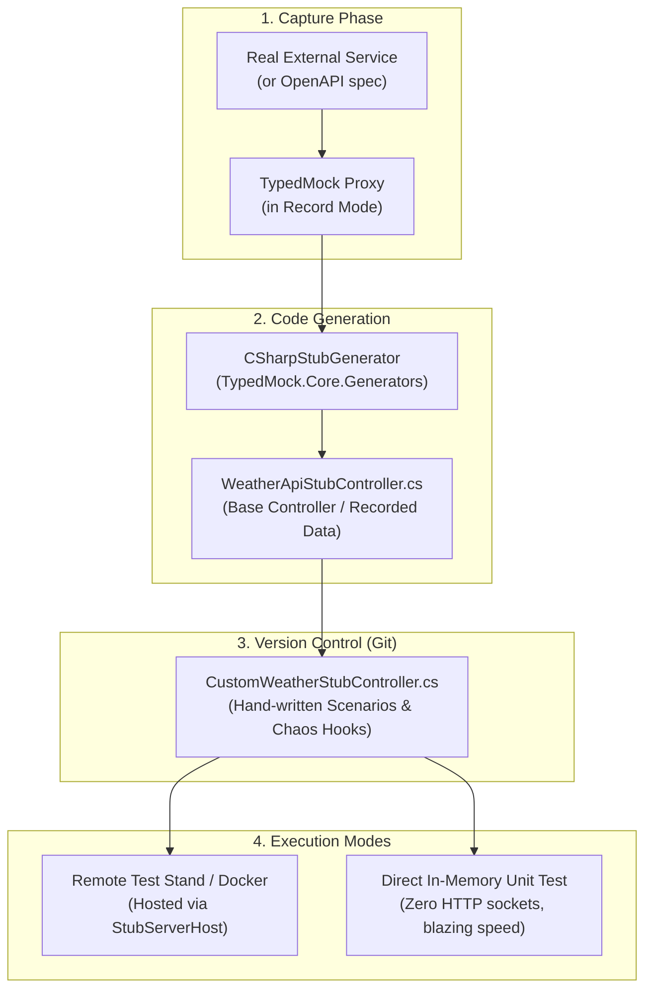

# Contract-Driven C# Code-Generated Stub Controllers

This architecture eliminates the need for runtime JSON fixtures and custom mock routing engines. Instead, it records real HTTP traffic and directly generates **strongly-typed C# ASP.NET Core controllers** that implement the shared contract interface (e.g. `IWeatherApi`).

---

## 1. Core Architecture: The Base + Override Pattern



---

## 2. What the Generated Code Looks Like

When recording against a contract like [`IWeatherApi`](file:///c:/Users/serge/RiderProjects/MockingProxyProofOfConcept/src/ExternalService.Contracts/IWeatherApi.cs), [`CSharpStubGenerator`](file:///c:/Users/serge/RiderProjects/MockingProxyProofOfConcept/src/TypedMock.Core/Generators/CSharpStubGenerator.cs) emits:

```csharp
// <auto-generated />
// Generated by TypedMock CSharpStubGenerator
// Source Contract: ExternalService.Contracts.IWeatherApi

using ExternalService.Contracts;
using Microsoft.AspNetCore.Mvc;
using System;
using System.Collections.Generic;
using System.Globalization;
using System.Net.Http;
using System.Threading.Tasks;

namespace Generated.Stubs;

[ApiController]
public partial class WeatherApiStubController : ControllerBase, IWeatherApi
{
    [HttpGet("weatherforecast")]
    public virtual async Task<List<WeatherForecastDto>> GetForecastsAsync()
    {
        var custom = await OnGetForecastsAsync();
        if (custom != null) return custom;

        return new List<WeatherForecastDto>
        {
            new WeatherForecastDto
            {
                Date = DateOnly.Parse("2026-11-05", CultureInfo.InvariantCulture),
                TemperatureC = 12,
                Summary = "Chilly",
                City = "London"
            },
            new WeatherForecastDto
            {
                Date = DateOnly.Parse("2026-11-05", CultureInfo.InvariantCulture),
                TemperatureC = 18,
                Summary = "Mild",
                City = "Paris"
            }
        };
    }

    [HttpGet("weatherforecast/{city}")]
    public virtual async Task<WeatherForecastDto> GetForecastByCityAsync([FromRoute(Name = "city")] string city)
    {
        var custom = await OnGetForecastByCityAsync(city);
        if (custom != null) return custom;

        return (city?.ToLowerInvariant()) switch
        {
            "london" =>
                new WeatherForecastDto
                {
                    Date = DateOnly.Parse("2026-11-05", CultureInfo.InvariantCulture),
                    TemperatureC = 12,
                    Summary = "Chilly",
                    City = "London"
                },
            "paris" =>
                new WeatherForecastDto
                {
                    Date = DateOnly.Parse("2026-11-05", CultureInfo.InvariantCulture),
                    TemperatureC = 18,
                    Summary = "Mild",
                    City = "Paris"
                },
            _ => throw new KeyNotFoundException($"No recorded stub for city '{city}'.")
        };
    }

    // -------------------------------------------------------------------------
    // Extensibility Hooks: Override in subclass to inject custom scenarios / chaos
    // -------------------------------------------------------------------------
    protected virtual Task<List<WeatherForecastDto>?> OnGetForecastsAsync() => Task.FromResult<List<WeatherForecastDto>?>(null);
    protected virtual Task<WeatherForecastDto?> OnGetForecastByCityAsync(string city) => Task.FromResult<WeatherForecastDto?>(null);
}
```

---

## 3. Controlling Scenarios via C# Code (No Mock DSL Needed)

Developers define scenarios, dynamic logic, or fault simulations directly in C#:

```csharp
[ApiController]
public class CustomWeatherStubController : WeatherApiStubController
{
    private int _callCounter = 0;

    protected override Task<WeatherForecastDto?> OnGetForecastByCityAsync(string city)
    {
        // Scenario 1: Custom edge-case data
        if (string.Equals(city, "StormCity", StringComparison.OrdinalIgnoreCase))
        {
            return Task.FromResult<WeatherForecastDto?>(new WeatherForecastDto
            {
                City = "StormCity",
                TemperatureC = -15,
                Summary = "Extreme Blizzard",
                Date = DateOnly.FromDateTime(DateTime.Today)
            });
        }

        // Scenario 2: Chaos simulation (transient 503 error)
        if (string.Equals(city, "FlakyStation", StringComparison.OrdinalIgnoreCase))
        {
            if (Interlocked.Increment(ref _callCounter) == 1)
            {
                throw new StubHttpException(503, "Weather station temporarily offline");
            }
        }

        // Return null to automatically fall back to the recorded baseline!
        return Task.FromResult<WeatherForecastDto?>(null);
    }
}
```

---

## 4. Compile-Time Contract Drift Detection

Because the generated controller explicitly implements `IWeatherApi`:
- If upstream changes a DTO property name, `dotnet build` fails immediately.
- If upstream renames a method or alters an argument, `CS0535` is triggered at compile time.
- Standard IDE refactoring (`F2` / `Shift+F6`) updates both your application code and your stubs simultaneously.

---

## 5. Evolution to OpenAPI / Swagger

While RestEase interfaces provide contract reflection in .NET, OpenAPI (`openapi.json` / `openapi.yaml`) is the broader industry standard:
1. **OpenAPI as Input Contract**: An `OpenApiContractScanner` can parse any OpenAPI 3.0/3.1 document (using `Microsoft.OpenApi.Readers`) into the exact same `ContractEndpoint` abstractions.
2. **OpenAPI as Output**: Because the generated stubs are native ASP.NET Core controllers, running `builder.Services.AddOpenApi()` in .NET 10 automatically produces an accurate OpenAPI specification for your mock service.
