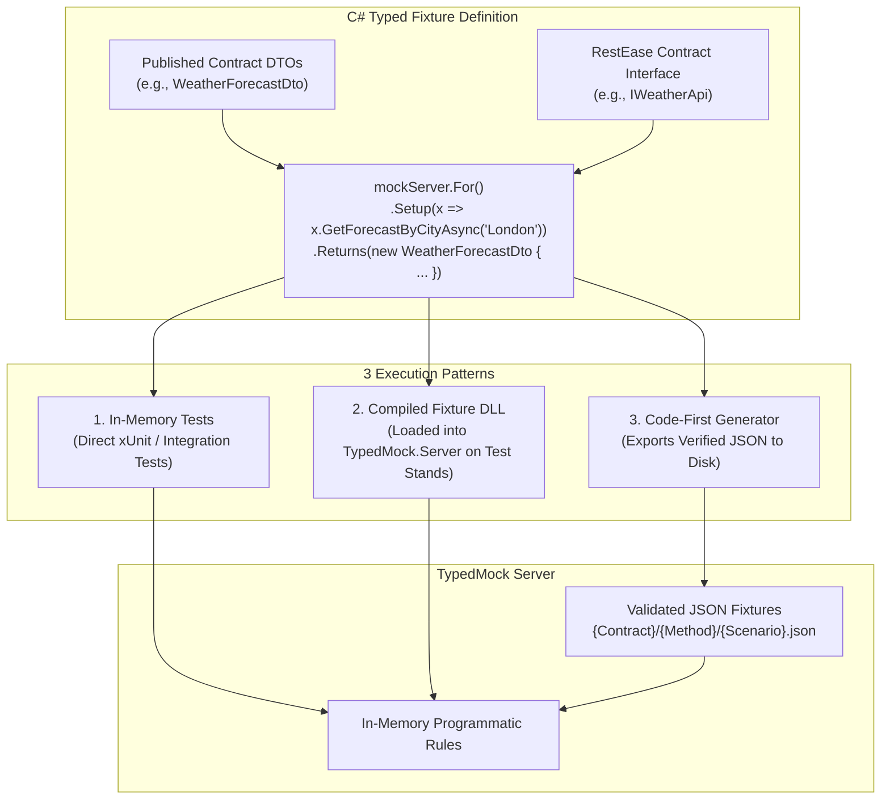

# Authoring C# Typed Fixtures vs. Raw JSON

Traditional mock proxies (such as WireMock, Mountebank, or MockServer) store traffic recordings as flat, untyped JSON files. While simple at first, raw JSON mocks quickly introduce maintenance problems:
1. **No Compile-Time Verification**: Renaming a property in a shared DTO leaves raw JSON files untouched, creating silent runtime test failures.
2. **No IntelliSense / Refactoring**: Developers and QA engineers must manually guess property names, casing conventions, and nested structures.
3. **Duplication**: Similar test cases duplicate large JSON blocks rather than reusing typed object builders.

`TypedMock` allows you to write **strongly-typed C# fixtures** using your published RestEase contract interfaces and DTOs.

---

## Architecture Overview



---

## 1. In-Memory C# Fixtures (For Integration Tests)

For unit and integration tests (such as xUnit, NUnit, or MSTest), you can declare mock scenarios directly in C# without creating or touching any JSON files on disk.

### Implementation:

```csharp
[Fact]
public async Task WeatherService_WhenStormReported_ReturnsWarning()
{
    // 1. Start mock server in Replay mode
    var options = new TypedMockOptions { Mode = MockMode.Replay };
    await using var mockServer = new TypedMockServer(options);

    // 2. Define strongly typed fixture directly in C#
    mockServer.For<IWeatherApi>()
        .Setup(x => x.GetForecastByCityAsync("London"))
        .WithScenario("StormWarning")
        .Returns(new WeatherForecastDto
        {
            City = "London",
            Date = DateOnly.FromDateTime(DateTime.Today),
            TemperatureC = 8,
            Summary = "Severe Thunderstorm"
        });

    // 3. Error simulation with status code
    mockServer.For<IWeatherApi>()
        .Setup(x => x.GetForecastByCityAsync("BrokenCity"))
        .ReturnsStatus(500, new { error = "Upstream weather station unreachable" });

    await mockServer.StartAsync();

    // 4. Act: RestEase client calls mockServer.BaseUrl
    var client = RestClient.For<IWeatherApi>(mockServer.BaseUrl);
    var forecast = await client.GetForecastByCityAsync("London");

    // 5. Assert
    forecast.Summary.Should().Be("Severe Thunderstorm");
}
```

### Key Advantages:
- **Zero Disk I/O**: Runs entirely in memory, maximizing test execution speed.
- **Refactoring Safe**: Renaming a field in `WeatherForecastDto` automatically updates all test setups via IDE refactoring (`Shift+F6` / `F2`).
- **Compiler Enforced**: If the external contract changes signature (e.g., parameter added), tests will fail to compile rather than failing at runtime.

---

## 2. Compiled C# Fixture Assemblies for Standalone Server (Test Stands & Containers)

When running `TypedMock.Server` as a standalone process (e.g., in a Docker container or Kubernetes pod on a test stand), you can load compiled **C# Fixture Assemblies** rather than mounting directories of JSON files.

### Step 1: Define a Fixture Interface

```csharp
namespace TypedMock.Core.Fixtures;

public interface IContractFixture<TContract> where TContract : class
{
    void Configure(ContractMockSetup<TContract> setup);
}
```

### Step 2: Implement Fixtures in a Class Library Project

Teams author scenarios in a standard C# project that references the contracts NuGet package:

```csharp
public class WeatherServiceFixtures : IContractFixture<IWeatherApi>
{
    public void Configure(ContractMockSetup<IWeatherApi> setup)
    {
        // Default scenario
        setup.Setup(x => x.GetForecastByCityAsync("London"))
             .Returns(new WeatherForecastDto
             {
                 City = "London",
                 TemperatureC = 20,
                 Summary = "Clear Sky"
             });

        // "Storm" scenario for QA functional testing
        setup.Setup(x => x.GetForecastByCityAsync("London"))
             .WithScenario("Storm")
             .Returns(new WeatherForecastDto
             {
                 City = "London",
                 TemperatureC = 5,
                 Summary = "Gale Warning"
             });

        // Edge case: Freezing temperatures
        setup.Setup(x => x.GetForecastByCityAsync("Oslo"))
             .Returns(new WeatherForecastDto
             {
                 City = "Oslo",
                 TemperatureC = -15,
                 Summary = "Blizzard"
             });
    }
}
```

### Step 3: Run the Server Pointing to the Assembly

```bash
dotnet run --project src/TypedMock.Server -- \
  --mode=Replay \
  --port=5050 \
  --fixtures-dll=./bin/MyTestStandFixtures.dll
```

At startup, `TypedMock.Server` uses reflection or `AssemblyLoadContext` to scan `MyTestStandFixtures.dll`, instantiate each `IContractFixture<T>`, and register all rules into memory.

---

## 3. C# Code-First Stub Controller Generator (Zero-JSON Approach)

Instead of generating and maintaining fragile JSON files, `TypedMock` can compile captured interactions directly into **ASP.NET Core controllers** (`WeatherApiStubController.cs`).

```csharp
// Record upstream traffic and save C# stub controller:
var mockServer = new TypedMockServer(new TypedMockOptions
{
    Mode = MockMode.Record,
    TargetUrl = "http://real-service:5001",
    OutputStubPath = "./GeneratedStubs/WeatherApiStubController.cs"
});
mockServer.RegisterContract<IWeatherApi>();
await mockServer.StartAsync();

// Execute recording client...

await mockServer.StopAsync(); // Automatically emits and saves WeatherApiStubController.cs
```

When generated, the controller uses deterministic pattern matching (`switch`) and compiles as part of your test project:
```csharp
[ApiController]
public partial class WeatherApiStubController : ControllerBase, IWeatherApi
{
    [HttpGet("weatherforecast/{city}")]
    public virtual async Task<WeatherForecastDto> GetForecastByCityAsync([FromRoute(Name = "city")] string city)
    {
        return (city?.ToLowerInvariant()) switch
        {
            "london" => new WeatherForecastDto { City = "London", TemperatureC = 12, Summary = "Chilly" },
            "paris" => new WeatherForecastDto { City = "Paris", TemperatureC = 18, Summary = "Mild" },
            _ => throw new StubNotFoundException($"No recorded stub for city '{city}'.")
        };
    }
}
```

**Benefits of the Zero-JSON approach:**
- No dead JSON files in your repository.
- 100% compile-time safety: contract changes fail `dotnet build` immediately.
- Refactor-safe: renaming a property in IDE automatically updates all stubs.

---

## 4. Reusable Object Builders with Bogus / Test Data Factories

Writing fixtures and stubs in C# unlocks the entire .NET test tooling ecosystem (such as [Bogus](https://github.com/bchavez/Bogus) for realistic fake data or custom domain builders):

```csharp
public class WeatherForecastBuilder
{
    private string _city = "London";
    private int _temperatureC = 20;
    private string _summary = "Sunny";

    public WeatherForecastBuilder ForCity(string city) { _city = city; return this; }
    public WeatherForecastBuilder AsStorm() { _temperatureC = 5; _summary = "Severe Storm"; return this; }
    public WeatherForecastBuilder AsHeatwave() { _temperatureC = 39; _summary = "Extreme Heat"; return this; }

    public WeatherForecastDto Build() => new()
    {
        City = _city,
        Date = DateOnly.FromDateTime(DateTime.Today),
        TemperatureC = _temperatureC,
        Summary = _summary
    };
}

// In your fixture setup:
setup.Setup(x => x.GetForecastByCityAsync("London"))
     .WithScenario("Storm")
     .Returns(new WeatherForecastBuilder().ForCity("London").AsStorm().Build());
```

---

## Comparison Matrix

| Feature | Raw JSON Fixtures | In-Memory C# Fixtures | C# Stub Controllers (Zero-JSON) |
| :--- | :--- | :--- | :--- |
| **Artifact Format** | Flat JSON files | In-memory lambda setups | C# Controllers (`.cs`) |
| **Compile-Time Safety** | ❌ None | ✅ Complete | ✅ Complete |
| **IDE Refactoring Support** | ❌ None | ✅ Full (`F2` / Rename) | ✅ Full (`F2` / Rename) |
| **IntelliSense Autocomplete** | ❌ None | ✅ Yes | ✅ Yes |
| **Works with Standalone Server** | ✅ Yes | ❌ In-process only | ✅ Yes (via `StubServerHost`) |
| **Git Diff Visibility** | ⚠️ Raw JSON blobs | ❌ In code only | ✅ Clean C# code diffs |
| **Reusable Builders / Faker** | ❌ No | ✅ Yes | ✅ Yes |
