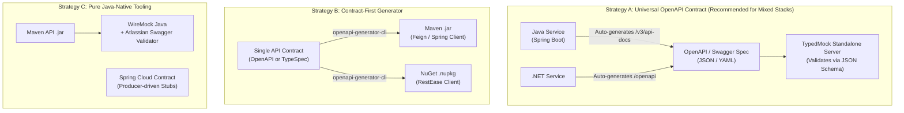

# Adapting Contract-Driven Mocking to Java Infrastructure

When integrating with or developing in a **Java microservices ecosystem**, you can achieve the exact same contract-driven benefits: eliminating schema drift, avoiding manual JSON file maintenance, and ensuring type-safe mocking.

This document details how the .NET/RestEase concepts map to Java, and describes the **three primary strategies** for implementing this pattern in a Java or hybrid environment.

---

## 1. Direct Concept Mapping: .NET vs Java

| Concept | .NET Ecosystem | Java Ecosystem |
| :--- | :--- | :--- |
| **Package Distribution** | **NuGet** (`.nupkg` via Nexus/Artifactory) | **Maven / Gradle** (`.jar` via Nexus/Artifactory) |
| **Declarative HTTP Client** | **RestEase** or Refit | **Spring Cloud OpenFeign**, **Spring 6 `@HttpExchange`**, or **Retrofit2** |
| **Data Models (DTOs)** | C# `record` / `class` | Java `record` / Lombok `@Data` |
| **Serialization Engine** | `System.Text.Json` / `Newtonsoft.Json` | **Jackson** (`ObjectMapper`) |

### Side-by-Side Code Comparison

#### .NET Contract (RestEase + NuGet):
```csharp
[BasePath("weatherforecast")]
public interface IWeatherApi
{
    [Get("{city}")]
    Task<WeatherForecastDto> GetForecastByCityAsync([Path("city")] string city);

    [Post]
    Task<WeatherForecastDto> CreateForecastAsync([Body] CreateForecastRequest request);
}

public record WeatherForecastDto(DateOnly Date, string City, int TemperatureC, string? Summary);
```

#### Java Contract (Spring 6 HTTP Interface or Spring Cloud OpenFeign + Maven Jar):
```java
@HttpExchange("/weatherforecast")
public interface WeatherApiClient {

    @GetExchange("/{city}")
    WeatherForecastDto getForecastByCity(@PathVariable("city") String city);

    @PostExchange
    WeatherForecastDto createForecast(@RequestBody CreateForecastRequest request);
}

public record WeatherForecastDto(LocalDate date, String city, int temperatureC, String summary) {}
```

In mature Java organizations, microservice teams publish a `<service>-client.jar` or `<service>-api.jar` to their internal Nexus/Artifactory containing these declarative interfaces and DTOs.

---

## 2. The Three Strategies for Java Integration



---

### Strategy A: Universal OpenAPI Contract (Recommended for Mixed Stacks)

If your architecture includes both .NET and Java services, relying on language-specific binary packages (.dll or .jar) can create cross-runtime friction. 

**The universal bridge is OpenAPI / Swagger.**

#### How It Works:
1. Java Spring Boot services expose their OpenAPI specifications out-of-the-box using `springdoc-openapi` (typically at `/v3/api-docs`).
2. `TypedMock.Server` can ingest this OpenAPI specification (either from a local JSON/YAML file or directly via HTTP from a running dev instance):
   ```bash
   dotnet run --project src/TypedMock.Server -- \
     --openapi=http://java-service:8080/v3/api-docs \
     --mode=Replay \
     --port=5050
   ```
3. **Route & Parameter Matching**: TypedMock extracts the URL templates, HTTP methods, and query/path parameters from the spec paths.
4. **Schema Safety & Drift Detection**: Instead of C# reflection, TypedMock validates incoming and recorded payloads against the OpenAPI specification's **JSON Schema** definitions (e.g., using `JsonSchema.Net`).

#### Advantages:
- **100% Language Agnostic**: Works equally well for Java, .NET, Go, Python, and Node.js.
- **Zero Binary Dependencies**: No need to download `.jar` or `.dll` files on test stands.
- **Always Up to Date**: Upstream Java services update their `/v3/api-docs` on every build.

---

### Strategy B: Contract-First API Design (Single Source of Truth)

For teams practicing API-First development:

1. The API contract is written in **OpenAPI (YAML)** or **TypeSpec**.
2. A centralized CI/CD pipeline uses `openapi-generator-cli` to produce:
   - For Java consumers: a Maven artifact (`.jar`) containing Spring Cloud Feign or Retrofit interfaces.
   - For .NET consumers: a NuGet artifact (`.nupkg`) containing RestEase or Refit interfaces.
3. Both ecosystems enjoy native compile-time safety and IDE autocompletion in their respective languages.
4. `TypedMock.Server` acts as the shared mock proxy for both platforms.

---

### Strategy C: Pure Java-Native Tooling (If Running Purely on the JVM)

If a team wants to run the mock server entirely within a Java runtime without .NET SDK/runtime present, the following Java-native tools implement this pattern:

#### 1. WireMock Java + Atlassian Swagger Request Validator
Java's native WireMock supports plugins. Using the `wiremock-openapi-extension` (backed by Atlassian's `swagger-request-validator`):
- WireMock intercepts incoming requests and outgoing stubs.
- It validates each stub against the service's OpenAPI contract.
- Any stub that returns an invalid or outdated schema is rejected with a validation exception, preventing contract drift.

#### 2. Spring Cloud Contract
In Spring Cloud Contract:
- The producing Java service defines contract specifications (in Groovy, YAML, or Java DSL).
- During the build of the producing service, tests verify that the real service complies with these contracts.
- Spring Cloud Contract automatically generates **WireMock stubs** and packages them into a `stubs.jar` published to Nexus.
- Consuming services (Java or .NET) add the stub jar as a dependency to replay verified mocks in tests.

---

## 3. Decision Matrix & Recommendations

| Scenario | Recommended Strategy | Primary Asset |
| :--- | :--- | :--- |
| **Heterogeneous Microservices (.NET + Java)** | **Strategy A (OpenAPI Ingestion)** | OpenAPI 3.0 / Swagger JSON (`/v3/api-docs`) |
| **Pure .NET Microservices** | **Current TypedMock Core** | NuGet RestEase Contract Packages |
| **Contract-First Enterprise Standards** | **Strategy B (TypeSpec / OpenAPI Generator)** | Single Contract Repo generating both `.nupkg` and `.jar` |
| **Pure Java Microservices on JVM** | **Strategy C (WireMock + Swagger Validator)** | WireMock Java + SpringDoc / Spring Cloud Contract |
