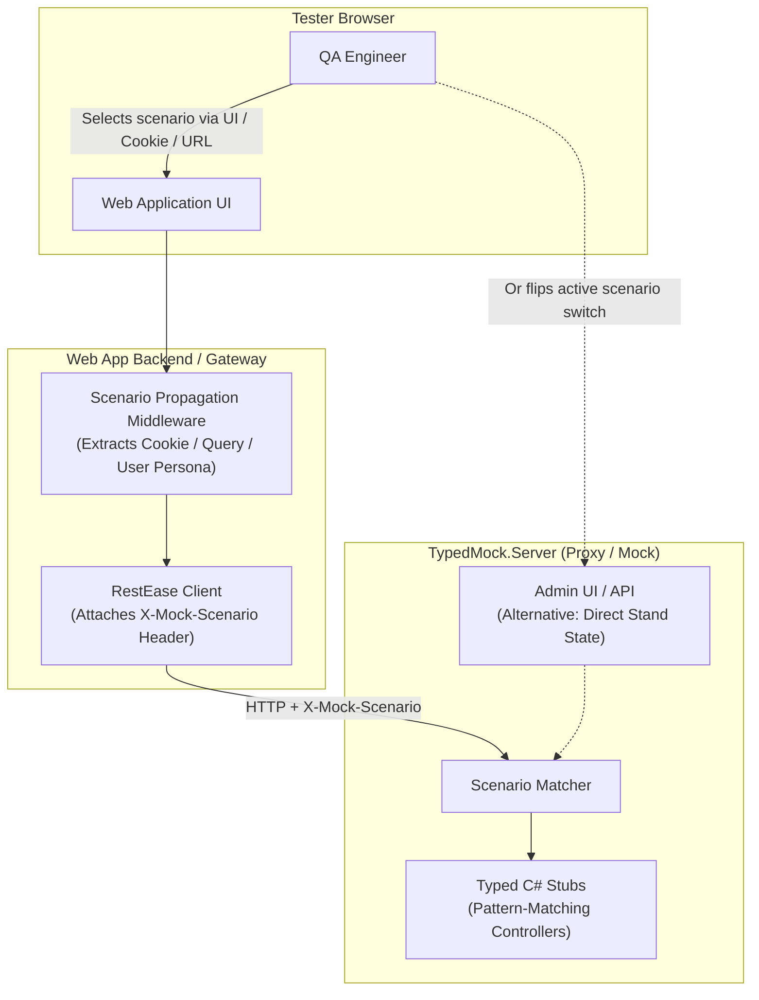

# Setting Up Scenario Fixtures on Test Stands for QA / Functional Testing

In automated unit and integration tests, selecting a mock scenario is trivial: test code configures `mockServer.For<IInterface>().Setup(...)` or injects an `X-Mock-Scenario` header into the HTTP client.

However, on a **shared or dedicated functional test stand**, testing engineers interact with the system via a **Web Application in a browser**. This introduces two major challenges:
1. **Testers cannot easily manipulate HTTP headers** in normal browser workflows.
2. Even if browser extensions (e.g., ModHeader) are used, **browser headers terminate at the front-facing web application or API Gateway**—they are not automatically forwarded downstream across internal microservices to `TypedMock`.

This document details the **architectures and patterns** available to configure and trigger mock scenarios in functional testing environments.

---

## Architecture Overview



---

## 1. Option 1: In-App QA Dev Toolbar + Cookie Propagation (Recommended for Best UX)

This is the most seamless experience for manual QA testers.

### How It Works:
1. On test-stand builds, the frontend web application embeds a small floating widget or dropdown menu (e.g., in the bottom corner of the page).
2. The tester selects a desired scenario (e.g., *"Weather Service: Storm Alert"*, *"Weather Service: 500 Down"*).
3. The widget sets a browser cookie:
   ```http
   Set-Cookie: X-Mock-Scenario=StormAlert; Path=/; SameSite=Lax
   ```
4. The backend web application registers an `HttpMessageHandler` (or RestEase request modifier) that reads the cookie from the current `HttpContext` and automatically attaches it to outbound contract calls.

### Implementation Pattern in ASP.NET Core Backend:

```csharp
// 1. DelegatingHandler in the Web App Backend
public class ScenarioHeaderPropagationHandler : DelegatingHandler
{
    private readonly IHttpContextAccessor _httpContextAccessor;

    public ScenarioHeaderPropagationHandler(IHttpContextAccessor httpContextAccessor)
    {
        _httpContextAccessor = httpContextAccessor;
    }

    protected override Task<HttpResponseMessage> SendAsync(
        HttpRequestMessage request, 
        CancellationToken cancellationToken)
    {
        var httpContext = _httpContextAccessor.HttpContext;
        if (httpContext != null)
        {
            // Read from Cookie or Query parameter
            if (httpContext.Request.Cookies.TryGetValue("X-Mock-Scenario", out var scenario) && 
                !string.IsNullOrWhiteSpace(scenario))
            {
                request.Headers.TryAddWithoutValidation("X-Mock-Scenario", scenario);
            }
        }

        return base.SendAsync(request, cancellationToken);
    }
}

// 2. Registration in Program.cs
builder.Services.AddHttpContextAccessor();
builder.Services.AddTransient<ScenarioHeaderPropagationHandler>();

builder.Services.AddHttpClient("WeatherApi", client => 
{
    client.BaseAddress = new Uri(builder.Configuration["Services:WeatherApi"]!);
})
.AddHttpMessageHandler<ScenarioHeaderPropagationHandler>();
```

**Pros:**
- Testers never touch developer tools or external utilities.
- Isolated per tester browser session (does not affect other testers on the same stand).
- Easily toggled on/off with a single click.

---

## 2. Option 2: URL Query Parameters (`?__scenario=...`) & Bookmarks

`TypedMock` natively resolves scenarios from the `?__scenario=<name>` query string.

### How It Works:
Testers navigate directly to URLs containing the scenario override:
```
https://teststand.internal/dashboard?__scenario=StormAlert
```

### Propagation:
The web application backend extracts `__scenario` from `httpContext.Request.Query["__scenario"]` and propagates it via the delegating handler shown above.

**Pros:**
- Zero frontend UI development required.
- **Linkable in test cases**: Testers can bookmark standard test situations (e.g., *"Case 3.1 - Weather API Failure"*) or paste reproducible URLs directly into Jira tickets.
- Compatible with single-page applications (SPAs) calling APIs directly.

---

## 3. Option 3: TypedMock Admin API & Interactive Web Dashboard

When the web application cannot be modified to forward headers or cookies, state can be managed directly on `TypedMock.Server`.

### How It Works:
`TypedMock.Server` exposes administrative control endpoints:

#### A. Global Stand Override:
```http
POST /__typedmock/scenarios/active
Content-Type: application/json

{
  "contract": "IWeatherApi",
  "method": "GetForecastByCityAsync",
  "scenario": "StormAlert"
}
```
All subsequent calls to that endpoint return the `StormAlert` fixture until reset.

#### B. IP / Session Scoped Override (Multi-Tester Safe):
```http
POST /__typedmock/scenarios/active
Content-Type: application/json

{
  "clientIp": "192.168.1.105",
  "scenario": "StormAlert"
}
```
`TypedMock` inspects `context.Connection.RemoteIpAddress` or `X-Forwarded-For` and applies the scenario only to requests originating from that specific tester.

#### C. Embedded Web UI (`/__typedmock/ui`):
`TypedMock.Server` can host a lightweight UI where QA engineers see a catalog of all registered contracts and methods, browse available C# stub scenarios, and click an **"Activate Scenario"** or **"Reset"** button.

---

## 4. Option 4: Test User Persona / Role-Based Scenarios

Instead of dynamic runtime toggles, mock responses are tied to specific **test accounts or user personas**.

### How It Works:
* Tester logs in as `qa_standard@test.com` $\rightarrow$ Backend requests `default` mock scenario.
* Tester logs in as `qa_weather_error@test.com` $\rightarrow$ Backend identifies the test persona and sends `X-Mock-Scenario: ServiceUnavailable` on downstream calls.
* Tester logs in as `qa_vip_high_temp@test.com` $\rightarrow$ Backend sends `X-Mock-Scenario: ExtremeHeat`.

**Pros:**
- Completely deterministic and reproducible.
- Multiple QA engineers and automated E2E suites (Cypress/Playwright) can test different scenarios concurrently on the same stand without conflicting.

---

## 5. Option 5: Input Data Conventions (Zero Setup Pattern Matching)

`TypedMock` automatically matches input parameters to deterministic C# switch cases.

### How It Works:
You can map recognized input keywords directly in the controller switch pattern:
* City input: `London` $\rightarrow$ resolves `new WeatherForecastDto { City = "London", ... }` (normal 200 OK).
* City input: `ErrorCity` or `London_500` $\rightarrow$ throws `StubHttpException(500, "Database error")`.
* City input: `SnowCity` $\rightarrow$ resolves cold weather DTO.

**Pros:**
- Works out-of-the-box today in `TypedMock` with zero code changes in the web app or proxy.
- Ideal for quick manual validation.

---

## 6. Option 6: W3C Distributed Tracing / Baggage Propagation

If your microservice ecosystem uses OpenTelemetry:

### How It Works:
1. OpenTelemetry standardizes the `baggage` HTTP header for propagating key-value pairs across service graphs:
   ```http
   baggage: mock-scenario=StormAlert
   ```
2. Any baggage injected at the browser layer (via OpenTelemetry JS SDK or gateway middleware) automatically propagates across all intermediate microservices down to `TypedMock`.
3. `TypedMock` reads the scenario from incoming baggage headers.

**Pros:**
- Operates automatically through complex microservice call chains without manual `DelegatingHandler` propagation at every hop.

---

## Summary Comparison Matrix

| Approach | Engineering Effort | Multi-User Isolation | QA Experience | Recommended For |
| :--- | :--- | :--- | :--- | :--- |
| **1. QA Dev Toolbar + Cookie** | Low (Backend delegating handler) | **High** (Per-browser cookie) | ⭐⭐⭐⭐⭐ **Best** | Primary approach for functional test stands |
| **2. Query Param (`?__scenario=`)** | Minimal | **High** (Per-request URL) | ⭐⭐⭐⭐ High | Bookmarking test links in Jira / test plans |
| **3. TypedMock Admin Web UI / API** | Low (Server feature) | Medium (Needs IP scoping) | ⭐⭐⭐⭐ High | Stand-wide overrides when backend cannot be modified |
| **4. Test User Personas** | Medium (Test data setup) | **High** (Isolated per account) | ⭐⭐⭐⭐ High | Automated regression & concurrent QA testing |
| **5. Input Data Conventions** | **Zero** (Built-in) | **High** (Per input payload) | ⭐⭐⭐ Good | Instant testing without any stand configuration |
| **6. Distributed Baggage (O-Tel)** | Medium (O-Tel infrastructure) | **High** (Trace-bound) | ⭐⭐⭐⭐ High | Deep microservice topologies (3+ hops) |
